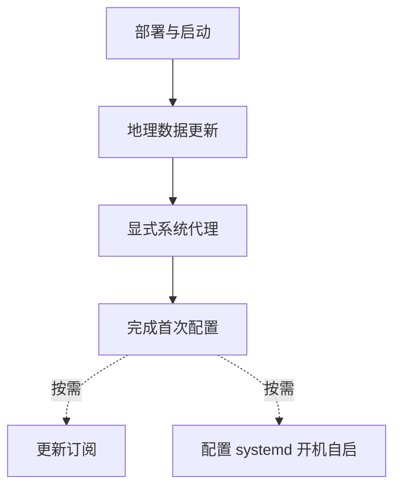

# Linux Mihomo 透明代理

在 Linux 上部署 Mihomo 透明代理，通过 TUN 接管流量，并使用 MetacubeXD 管理节点。



## 当前配置

| 配置项       | 当前值 / 行为                                                                 |
| ------------ | ----------------------------------------------------------------------------- |
| 运行模式     | `rule`，按规则分流                                                          |
| 代理端口     | `mixed-port: 7890`，支持 HTTP / SOCKS5；`allow-lan: false`                |
| 控制接口     | `0.0.0.0:9090`，认证使用 `secret`                                         |
| 面板目录     | `./metacubexd-ui`，相对于 Mihomo 工作目录                                   |
| TUN          | 默认启用，`mixed` 协议栈，自动路由和网卡检测，劫持 `any:53` DNS 请求      |
| TUN 路由排除 | `192.168.0.0/16`、`127.0.0.0/8`、`10.0.0.0/8`、`172.16.0.0/12` |
| DNS          | `fake-ip`，地址池 `198.18.0.1/16`，上游为 `223.5.5.5`、`119.29.29.29` |
| IPv6         | 全局启用；DNS 的 AAAA 解析关闭（`dns.ipv6: false`）                         |
| 地理数据     | `geodata-mode: false`，使用 `Country.mmdb` 和 `geosite.dat`             |
| 分流规则     | 私有地址及国内流量直连，广告域名拒绝，其余流量交给“🚀 节点选择”             |

节点组包含“🚀 节点选择”（手动选择）、“♻️ 自动选择”（自动测速）和“🛡️ 故障转移”，面板中的选择会自动保存。“♻️ 自动选择”排除香港及流量、到期等信息节点。

## 部署与启动

以下以 `/opt/clash` 为工作目录，命令在具备相应权限的 Linux 环境中执行。仓库内核为 `amd64-compatible`，其他架构请从 [Mihomo Releases](https://github.com/MetaCubeX/mihomo/releases) 下载对应版本。

### 1. 准备运行文件

在仓库目录执行，将内核、配置、数据文件和更新脚本复制到工作目录：

```sh
sudo mkdir -p /opt/clash
sudo cp mihomo-linux-amd64-compatible config.yaml Country.mmdb geosite.dat update_config.py /opt/clash/
cd /opt/clash
sudo chmod +x mihomo-linux-amd64-compatible
```

### 2. 安装控制面板

下载并解压 [MetacubeXD](https://github.com/MetaCubeX/metacubexd/releases) 面板，目录须与 `external-ui` 一致：

```sh
sudo mkdir -p /opt/clash/metacubexd-ui
sudo curl -fL -o /opt/clash/metacubexd-ui/compressed-dist.tgz \
  https://github.com/MetaCubeX/metacubexd/releases/latest/download/compressed-dist.tgz
sudo tar -xzf /opt/clash/metacubexd-ui/compressed-dist.tgz -C /opt/clash/metacubexd-ui
sudo rm /opt/clash/metacubexd-ui/compressed-dist.tgz
```

### 3. 检查配置并启动

启动前按需修改 `/opt/clash/config.yaml` 中的节点、规则及 `secret`。在 `/opt/clash` 目录执行以下命令，先检查配置，检查通过后启动（TUN 需要网络管理权限）：

```sh
sudo ./mihomo-linux-amd64-compatible -t -d /opt/clash
sudo ./mihomo-linux-amd64-compatible -d /opt/clash
```

### 4. 访问控制面板

| 项目     | 填写内容                        |
| -------- | ------------------------------- |
| 面板地址 | `http://<主机IP>:9090/ui/`    |
| 控制接口 | `http://<主机IP>:9090`        |
| 密钥     | `config.yaml` 中的 `secret` |

控制接口监听所有 IPv4 网卡，请修改默认密钥，并通过防火墙限制访问来源。

## 地理数据更新

手动更新时，保存到 Mihomo 工作目录，并保留本地文件名 `Country.mmdb` 的大小写：

```sh
sudo curl -fL -o /opt/clash/geosite.dat \
  https://testingcf.jsdelivr.net/gh/MetaCubeX/meta-rules-dat@release/geosite.dat
sudo curl -fL -o /opt/clash/Country.mmdb \
  https://testingcf.jsdelivr.net/gh/MetaCubeX/meta-rules-dat@release/country.mmdb
```

更新完成后重启 Mihomo：前台运行时按 `Ctrl+C` 停止后重新启动；通过 systemd 运行时执行 `sudo systemctl restart clash`。

## 显式系统代理

此项为必填步骤。请将以下代理环境变量加入 `~/.bashrc` 文件，使新打开的 Bash 终端自动使用代理：

```sh
export http_proxy="http://127.0.0.1:7890"
export https_proxy="http://127.0.0.1:7890"
export all_proxy="socks5h://127.0.0.1:7890"
export no_proxy="localhost,127.0.0.1,::1,127.0.0.0/8,10.0.0.0/8,172.16.0.0/12,192.168.0.0/16"
```

`no_proxy` 指定本机及局域网 IPv4 私有网段（`10.0.0.0/8`、`172.16.0.0/12`、`192.168.0.0/16`）直连。

保存文件后，执行以下命令刷新配置，使其在当前终端立即生效：

```sh
source ~/.bashrc
```

## 更新订阅

`update_config.py` 通过订阅转换接口获取配置，仅替换 `proxies`、`proxy-groups` 和 `rules`，保留 TUN、DNS、控制接口及地理数据下载源等其他配置。更新会覆盖当前自定义节点组和规则。

### 1. 安装依赖并更新

在 `/opt/clash` 目录执行，配置文件需对运行脚本的用户可写：

```sh
python -m pip install requests ruamel.yaml
python update_config.py "你的订阅链接" --config /opt/clash/config.yaml
```

| 参数                | 说明                                                     |
| ------------------- | -------------------------------------------------------- |
| 订阅链接            | 建议显式传入；省略时使用脚本内置默认链接                 |
| `--config <路径>` | 指定配置文件，默认读取当前目录的 `config.yaml`         |
| `--no-backup`     | 关闭备份；默认生成配置文件同目录下的 `config.yaml.bak` |

### 2. 检查并重启

```sh
sudo /opt/clash/mihomo-linux-amd64-compatible -t -d /opt/clash
```

检查通过后，前台运行时停止进程并重新启动；通过 systemd 运行时执行 `sudo systemctl restart clash`。

## systemd 开机自启（可选）

### 1. 创建服务文件

创建 `/etc/systemd/system/clash.service`：

```ini
[Unit]
Description=Mihomo Proxy
Wants=network-online.target
After=network-online.target

[Service]
Type=simple
WorkingDirectory=/opt/clash
ExecStart=/opt/clash/mihomo-linux-amd64-compatible -d /opt/clash
Restart=on-failure
LimitNOFILE=1000000

[Install]
WantedBy=multi-user.target
```

### 2. 启用开机自启

启用服务前先停止手动运行的进程，避免端口冲突：

```sh
sudo systemctl daemon-reload
sudo systemctl enable --now clash
```

### 3. 管理服务与查看日志

```sh
sudo systemctl restart clash   # 重启服务
sudo systemctl stop clash      # 停止服务
sudo systemctl status clash    # 查看运行状态
sudo journalctl -u clash -f    # 持续查看日志
```
